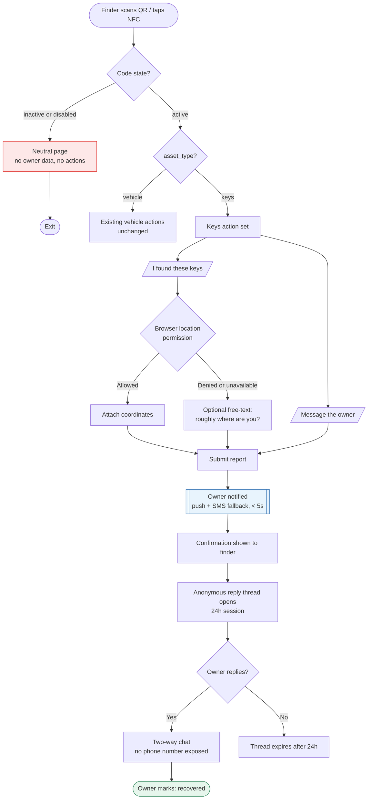
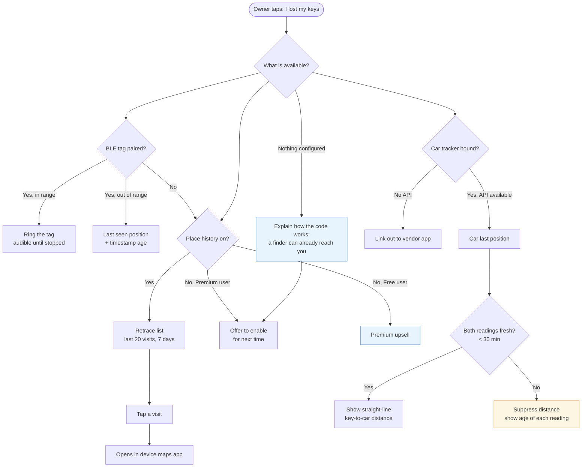
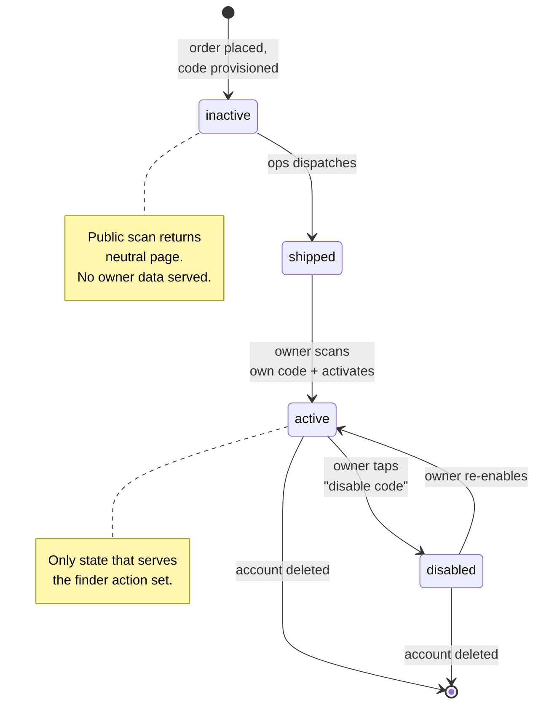
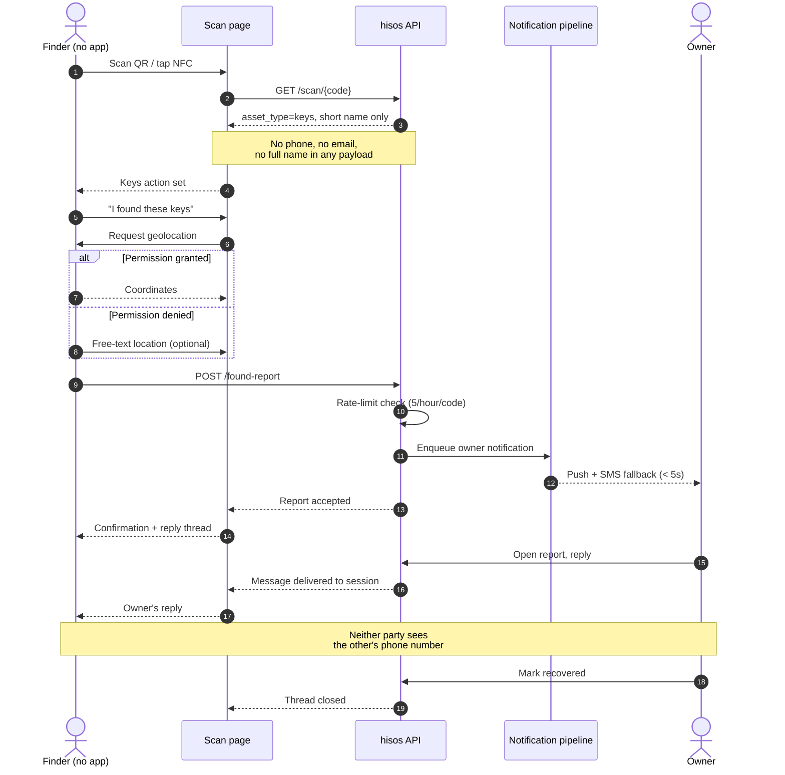
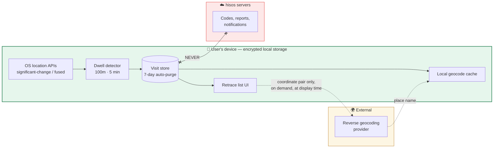
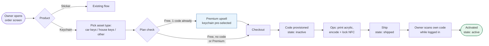
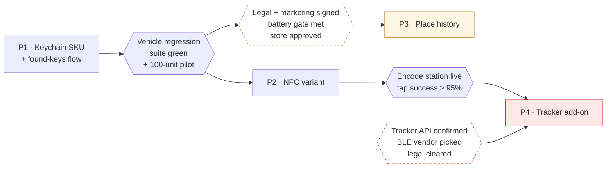

# Feature PRD — Smart Keychain (المفتاح الذكي)

| Field | Value |
|---|---|
| **Product** | hisos.app (هاي طوارئ) |
| **Feature** | Smart Keychain — QR/NFC keychain, place history, tracker add-on |
| **Suggested repo path** | `docs/features/smart-keychain/PRD.md` |
| **Status** | Draft v0.1 — for review |
| **Author** | Mahmoud Adel |
| **Date** | 2026-10-21 |
| **Related docs** | `docs/rfcs/XXXX-smart-keychain.md` (to be written), SRS (to be updated post-launch) |

> **Note on assumptions.** Every decision marked 🅐 is an assumption taken from the existing business so this document could be written without blocking. Each one is listed in §14 and needs a yes/no before build starts.

---

## 1. Problem & Goal

### 1.1 Problem

hisos today protects **vehicles**. The sticker lives on a windshield and the dominant scan action is "العربية قافلة عليك". But the same core mechanic — a stranger scans a code, the owner is reached, the owner's phone number is never exposed — solves a much more frequent and more painful problem: **lost keys**.

Losing car or house keys in Egypt today means: no way for a finder to reach you, no record of where you've been, and a locksmith or dealer key replacement that costs thousands of EGP and days of disruption. Finders *want* to return keys — they have no safe channel to do it. Writing a phone number on a keyring is exactly the privacy exposure hisos exists to remove.

### 1.2 Goal

Extend hisos from a vehicle product to a **personal-belongings** product, starting with keys, by shipping:

1. A physical **acrylic keychain** carrying the user's hisos code (QR, and optionally NFC).
2. A **found-keys scan flow** tuned for keys, not cars.
3. An opt-in, on-device **place history** so a user who lost keys can retrace where they stopped.
4. A paid **tracker add-on** for users who want live location.

### 1.3 Business value

- **New revenue line**: a physical SKU with margin, sold to an existing base of 12,000+ users with zero acquisition cost.
- **Premium conversion**: place history is a strong, demonstrable Premium-only feature — stronger than "unlimited contacts".
- **Code multiplication**: today most users own one code on one car. Keys give a second code per user, which is the paid tier.
- **Category expansion**: proves the "كود واحد لكل حاجة" promise already on the marketing site with a real second product.

### 1.4 Non-goals

- Not a pet tracker, child tracker, or fleet asset tracker (fleet is a separate product line).
- Not a replacement for the vehicle sticker.
- Not building our own tracker hardware.
- Not expanding outside Egypt in this release.

---

## 2. Success Metrics

| Metric | Baseline | Target (90 days post-launch) | Owner |
|---|---|---|---|
| **Primary** — Free → Premium conversion rate | current rate | +40% relative | Product |
| Keychain units sold | 0 | 1,500 | Commercial |
| Keychain attach rate (existing users buying one) | 0 | 8% of active users | Product |
| Place-history opt-in rate (Premium users) | 0 | ≥ 50% | Product |
| **Recovery rate** — scans on a `keys` code that end in owner-confirmed return | 0 | ≥ 60% | Product |
| Median time from scan to owner notification delivered | — | < 5s (match existing SLA) | Engineering |
| Crash-free sessions after background-location rollout | current | no regression > 0.2% | Engineering |
| Day-7 uninstall rate after enabling place history | current | no regression > 1pt | Engineering |

**Counter-metric (guardrail):** support tickets mentioning privacy/tracking. If this rises more than 2× post-launch, pause Phase 3 rollout.

---

## 3. Scope

### In scope

| Phase | Epic | Summary |
|---|---|---|
| **P1** | Keychain SKU + found-keys flow | New acrylic QR keychain, new `keys` asset type, keys-specific scan actions |
| **P2** | NFC variant | NTAG213 tag embedded in the keychain, same URL as the QR |
| **P3** | Place history | Opt-in, on-device dwell detection, "فين مفاتيحي؟" retrace list, Premium-only |
| **P4** | Tracker add-on | BLE key tag for keys + resale of GSM tracker for the car, distance between the two |

### Out of scope (this release)

- Dynamic/encrypted NFC (NTAG 424 DNA anti-cloning) — see §13 Risks
- Server-side location history or any location data leaving the device
- Web access to place history
- Finder reward / مكافأة mechanics
- Multi-user shared assets (family sharing a keychain)
- Markets outside Egypt

---

## 4. Personas / Actors

| Actor | Description | Primary need |
|---|---|---|
| **Owner** | Existing or new hisos account holder | Get keys back; never expose their number |
| **Finder** | Stranger who found the keys. No app, no account, may decline location | Return the keys with minimum friction and zero personal risk |
| **Emergency contact** | Already in the system | Not involved in the keys flow by default 🅐 |
| **Ops / fulfilment** | Prints, encodes, packs, ships | Produce a correct physical item tied to the right code |
| **Support** | Existing support team | Resolve "my scan didn't arrive", "my keychain broke", tracker issues |

---

## 5. Key Product Decisions (assumed)

| # | Decision | Rationale |
|---|---|---|
| 🅐1 | **One code per asset**, not one code per user. A keychain gets its own code, distinct from the car sticker. | The scan action set differs by asset. A finder of keys must not see "العربية قافلة عليك". Also drives the Premium upsell. |
| 🅐2 | Keychain is **purchasable on Free**; owning a *second* active code requires Premium. | Lowers purchase friction, keeps the paywall where it already is. |
| 🅐3 | Keys scans notify **the owner only** — not emergency contacts. | Lost keys is not an emergency. SMS-blasting family for a keyring erodes trust in the emergency channel. |
| 🅐4 | Finder location is **optional**, never a hard gate. | Browser geolocation is frequently declined, and desktop geolocation is useless. A declined prompt must not block the return. |
| 🅐5 | Place history is **on-device only**, never uploaded. | Preserves the public promise "مفيش تتبّع دائم". Removes hisos as a location data controller. Cuts store-review and breach risk. |
| 🅐6 | NFC v1 is a **static URL on NTAG213**, encoded and locked in-house. | Zero backend change; the tap resolves to the same scan page as the QR. |
| 🅐7 | Tracker strategy is **split**: BLE tag for keys, GSM tracker for the car. | The sourced GSM unit (3.5×2×1.4cm, 400mAh, 4–6 days) cannot live on a keyring. See §13. |

---

## 6. User Stories & Acceptance Criteria

### Epic P1 — Keychain SKU and found-keys flow

**US-1.1 — Order a keychain**
> As an owner, I want to order a hisos keychain from the app, so that my keys are protected the same way my car is.

- **AC-1.1.1** — Given I am a logged-in user, when I open the code-ordering screen, then I see "استيكر" and "ميدالية" as selectable product types with price and preview.
- **AC-1.1.2** — Given I select "ميدالية", when I proceed, then I must choose the asset it protects (مفاتيح العربية / مفاتيح البيت / حاجة تانية) before checkout.
- **AC-1.1.3** — Given I am on Free and already have one active code, when I try to order a second, then I see the Premium upgrade screen with the keychain pre-selected after upgrade.
- **AC-1.1.4** — Given my order is placed, when it is confirmed, then a code is provisioned in `inactive` state and appears in my codes list with status "جاري التجهيز".
- **AC-1.1.5** — Given my order is placed, when ops ship it, then I receive a notification with a tracking reference, and the code moves to "تم الشحن".

**US-1.2 — Activate the keychain**
> As an owner, I want to activate my keychain when it arrives, so that scans start reaching me.

- **AC-1.2.1** — Given I received the keychain, when I scan my own code while logged in, then I am taken to an activation screen, not the public finder page.
- **AC-1.2.2** — Given I complete activation, when anyone scans the code afterwards, then the public finder page is served.
- **AC-1.2.3** — Given the code is not yet activated, when a stranger scans it, then they see a neutral "الكود ده لسه مش مفعّل" page with no owner data and no actions.

**US-1.3 — Find keys and reach the owner**
> As a finder, I want to tell the owner I found their keys without giving away who I am, so that I can help without risk.

- **AC-1.3.1** — Given I scan a keychain code, when the page loads, then I see keys-specific actions: "لقيت المفاتيح دي" and "ابعت رسالة" — and **not** "العربية قافلة عليك".
- **AC-1.3.2** — Given I tap "لقيت المفاتيح دي", when the browser asks for location and I **allow**, then the owner is notified with a map link to my position and the notification states my location was shared.
- **AC-1.3.3** — Given I **decline** location, when I continue, then the flow still completes, the owner is notified without coordinates, and I am offered a free-text field to describe where I am.
- **AC-1.3.4** — Given I complete the report, when it is submitted, then I see a confirmation that the owner was notified, and the owner's name is shown only in short form ("أحمد م.") with no phone number anywhere in the page or network responses.
- **AC-1.3.5** — Given I submitted a report, when the owner replies, then I can continue the conversation on the same page without registering, for a bounded session (🅐 24h).

**US-1.4 — Receive and act on a found-keys report**
> As an owner, I want to be told immediately when someone finds my keys, so that I can arrange to get them back.

- **AC-1.4.1** — Given a finder submits a report, when it is processed, then I receive a push notification and an SMS fallback within 5 seconds.
- **AC-1.4.2** — Given I open the notification, when the report loads, then I see time, finder location (if shared), the finder's note, and a reply box.
- **AC-1.4.3** — Given I reply, when the message sends, then it is delivered to the finder's open session and my phone number is not included in the payload.
- **AC-1.4.4** — Given the keys are returned, when I mark the report "تم الاسترجاع", then the report closes and the recovery is counted for metrics.
- **AC-1.4.5** — Given I suspect abuse, when I tap "إيقاف الكود", then the code is disabled immediately and all further scans show the inactive page.

### Epic P2 — NFC

**US-2.1 — Tap instead of scan**
> As a finder, I want to tap the keychain with my phone, so that I don't have to open a camera app.

- **AC-2.1.1** — Given an NFC-equipped keychain, when a compatible phone taps it with NFC on, then the device opens the same public scan URL as the QR.
- **AC-2.1.2** — Given NFC is unavailable, off, or unsupported, when a finder looks at the keychain, then a printed QR is present on the same item as a fallback.
- **AC-2.1.3** — Given the tag is encoded at fulfilment, when it ships, then the tag is write-locked and cannot be reprogrammed.
- **AC-2.1.4** — Given an NFC tap and a QR scan of the same keychain, when either resolves, then the server cannot distinguish them for billing but **does** record the medium (`nfc` / `qr`) for analytics.

### Epic P3 — Place history

**US-3.1 — Opt in to place history**
> As a Premium owner, I want hisos to remember where I stopped, so that I can retrace my steps when I lose something.

- **AC-3.1.1** — Given I am Premium, when I open the keychain screen, then I see an explicit, disabled-by-default "أماكن مريت بيها" setting with a plain-language explanation of what is recorded, where it is stored, and for how long.
- **AC-3.1.2** — Given I enable it, when the OS permission sheet appears, then it requests background/always location with a purpose string that matches the in-app explanation word for word.
- **AC-3.1.3** — Given I enable it, when data is recorded, then it is written only to encrypted local storage on the device and **no location payload is sent to any hisos server**.
- **AC-3.1.4** — Given I am on Free, when I open the setting, then I see the Premium upsell and no permission prompt is triggered.
- **AC-3.1.5** — Given I disable it, when I confirm, then all stored places are deleted from the device immediately and the OS permission is released.

**US-3.2 — Automatic dwell detection**
> As the system, I need to detect where the user actually stopped, so that the retrace list is short and useful.

- **AC-3.2.1** — Given place history is on, when the user remains within a **100m** radius for **≥ 5 minutes**, then a visit is recorded with entry time, exit time and centroid.
- **AC-3.2.2** — Given two visits to the same centroid are separated by less than **15 minutes**, when they are stored, then they are merged into one visit.
- **AC-3.2.3** — Given a visit is older than **7 days**, when the purge job runs, then it is deleted from the device.
- **AC-3.2.4** — Given more than **20** visits exist, when the list is displayed, then only the most recent 20 are shown.
- **AC-3.2.5** — Given the device is moving continuously, when no dwell threshold is met, then nothing is recorded (we store visits, not routes).

**US-3.3 — "I lost my keys" retrace**
> As an owner without a tracker, I want a list of the places I stopped today, so that I know where to go look.

- **AC-3.3.1** — Given I tap "ضاعت مني المفاتيح", when I have place history on, then I see a reverse-chronological list of visits with place name, address, arrival time and duration.
- **AC-3.3.2** — Given a visit is displayed, when I tap it, then it opens in the device's default maps app with directions.
- **AC-3.3.3** — Given a place name is needed, when the list is opened, then reverse geocoding is requested **on demand only**, and each resolved name is cached locally so the same place is never geocoded twice.
- **AC-3.3.4** — Given place history is off or empty, when I tap "ضاعت مني المفاتيح", then I see what hisos *can* still do: how the code works, how to reach me if someone finds them, and an offer to enable place history for next time.
- **AC-3.3.5** — Given I lost the phone too, when I log in on another device, then I am told plainly that place history lives only on the original device and is not recoverable.

### Epic P4 — Tracker add-on

**US-4.1 — Attach a BLE key tag**
> As an owner, I want a small tag on my keys that my phone remembers, so that I can see where I last had them.

- **AC-4.1.1** — Given I own a supported BLE tag, when I pair it in the app, then it is bound to one of my codes and appears on the keychain screen.
- **AC-4.1.2** — Given the tag is in range, when I tap "رنّ", then the tag emits sound until I stop it.
- **AC-4.1.3** — Given the tag goes out of range, when the connection drops, then the last known position and timestamp are stored **on-device** and shown as "آخر مكان شُوهد فيه".
- **AC-4.1.4** — Given the tag battery is low, when it reports below threshold, then I receive a notification.

**US-4.2 — Car tracker and key-to-car distance**
> As an owner with both a car tracker and a key tag, I want to know how far my keys are from my car, so that I know whether to search the car or elsewhere.

- **AC-4.2.1** — Given I have purchased a GSM car tracker through hisos, when I open the vehicle screen, then I see its last reported position.
- **AC-4.2.2** — Given both a car position and a key tag last-known position exist, when both are fresher than a staleness threshold (🅐 30 min), then I see the straight-line distance between them and the age of each reading.
- **AC-4.2.3** — Given either reading is stale, when the screen loads, then the distance is suppressed and each reading is labelled with its age — we never present a stale distance as current.
- **AC-4.2.4** — Given no tracker platform API is available, when the user opens the tracker screen, then hisos shows purchase/support information and links out to the vendor app, and the distance feature is hidden entirely. *(This AC exists because the dependency in §12 is unresolved.)*

---

## 7. Functional Requirements

### Catalogue & codes

- **FR-1** The system shall support a `tag_medium` on every code: `sticker`, `keychain_qr`, `keychain_nfc`.
- **FR-2** The system shall support an `asset_type` on every code: `vehicle`, `keys`, `bag`, `motorcycle`, `other`.
- **FR-3** The public scan page shall render its action set from `asset_type`. Vehicle actions shall not appear on a `keys` code, and vice versa.
- **FR-4** The system shall allow one user to hold multiple codes, with the count enforced by plan: Free = 1 active code, Premium = unlimited.
- **FR-5** Codes shall be provisioned in `inactive` state at order time and transition `inactive → shipped → active → disabled`.
- **FR-6** A scan of an `inactive` or `disabled` code shall return a neutral page exposing no owner data.

### Found-keys flow

- **FR-7** The scan page for `asset_type = keys` shall offer "لقيت المفاتيح دي" and "ابعت رسالة".
- **FR-8** The system shall request browser geolocation for a found-keys report and shall complete the report when permission is denied or unavailable.
- **FR-9** The system shall provide a free-text location description field, maximum 300 characters, sanitised before storage and display.
- **FR-10** The system shall notify the owner by push with SMS fallback within 5 seconds of report submission, reusing the existing notification pipeline.
- **FR-11** The system shall provide an anonymous, session-bounded two-way message thread between finder and owner, expiring after 24 hours of inactivity.
- **FR-12** The system shall never include the owner's phone number, full name, email or address in any response served to an unauthenticated scanner — including API payloads, headers and error bodies.
- **FR-13** The owner shall be able to mark a report as recovered, which closes the thread.
- **FR-14** The owner shall be able to disable any code instantly from the app; the change shall take effect on the next scan with no cache delay beyond 60 seconds.
- **FR-15** The system shall rate-limit found-keys reports per code to prevent harassment (🅐 5 reports per code per hour).

### NFC

- **FR-16** NFC tags shall be encoded as NDEF URI records pointing to the same canonical scan URL as the code's QR.
- **FR-17** Tags shall be write-locked at fulfilment.
- **FR-18** The scan URL shall carry a medium parameter so NFC and QR scans are distinguishable in analytics without affecting behaviour.
- **FR-19** Every NFC keychain shall also carry a printed QR on the same physical item.

### Place history

- **FR-20** Place history shall be disabled by default and require an explicit in-app opt-in before any OS permission is requested.
- **FR-21** Place history shall be available to Premium subscribers only.
- **FR-22** Visit detection shall use battery-efficient platform APIs: significant-location-change / visit monitoring on iOS, fused location with activity recognition on Android. Continuous high-accuracy GPS is prohibited.
- **FR-23** A visit shall be recorded when the device remains within a 100m radius for ≥ 5 minutes.
- **FR-24** Visits within 15 minutes at the same centroid shall be merged.
- **FR-25** Visit records shall be stored exclusively in encrypted on-device storage. No location data shall be transmitted to hisos servers or any third party except the reverse-geocoding provider, and then only as a coordinate pair at display time.
- **FR-26** Visits shall be purged automatically after 7 days.
- **FR-27** Disabling the feature shall delete all stored visits immediately and release the OS permission.
- **FR-28** Reverse geocoding shall be invoked on demand at list-display time only, and results shall be cached locally per centroid.
- **FR-29** The app shall display a retrace list of up to 20 most recent visits, reverse-chronological, each opening in the device maps app.
- **FR-30** Parameters in FR-23, FR-24, FR-26 and FR-29 shall be remote-configurable without an app release.

### Tracker add-on

- **FR-31** The system shall support binding a supported BLE tag to a code, with ring, last-seen position, and low-battery notification.
- **FR-32** BLE last-seen positions shall be stored on-device under the same rules as place history (FR-25, FR-26).
- **FR-33** The system shall support selling a GSM car tracker as a paid add-on with explicit disclosure of the SIM requirement and its recurring cost.
- **FR-34** Where a tracker platform API is available, the system shall display last known vehicle position and, when both readings are fresh, the straight-line distance between vehicle and keys.
- **FR-35** Where no API is available, tracker features shall degrade to purchase and support information only.
- **FR-36** Distance shall be suppressed when either reading exceeds the staleness threshold; the age of each reading shall always be displayed.

---

## 8. Non-Functional Requirements

| ID | Requirement |
|---|---|
| **NFR-1** | Scan page shall render in < 2s on 3G on a mid-range Android device. Finders are strangers doing a stranger a favour — any latency loses them. |
| **NFR-2** | Scan page shall work with no app, no login, no JS framework dependency beyond what is already shipped. |
| **NFR-3** | Owner notification delivery shall match the existing < 5s SLA. |
| **NFR-4** | Battery impact of place history shall not exceed 3% of daily battery on a reference device over a normal day. Measured before rollout; a regression beyond this blocks release. |
| **NFR-5** | All location data at rest on device shall be encrypted using platform keystore APIs. |
| **NFR-6** | No PII of the owner shall ever be exposed to an unauthenticated scanner (duplicate of FR-12, restated as a security control and covered by an automated test). |
| **NFR-7** | Scan pages and all new UI shall be RTL-first Arabic, with English parity matching the existing site's language toggle. |
| **NFR-8** | All new endpoints shall be rate-limited and protected against enumeration of valid codes. |
| **NFR-9** | The reverse-geocoding provider shall be swappable behind an interface; no provider-specific types in domain code. |
| **NFR-10** | Place history shall function offline; geocoding failure shall degrade to showing coordinates and a map link, never an error state. |
| **NFR-11** | Privacy policy, terms and the App Store / Play data-safety declarations shall be updated and live **before** the Phase 3 build is submitted for review. |

---

## 9. Impact on the Existing System

| Area | Impact | Risk |
|---|---|---|
| **Codes model** | New columns `asset_type`, `tag_medium`, state machine formalised. Existing codes backfilled as `asset_type = vehicle`, `tag_medium = sticker`. | Low — additive, backfill is deterministic |
| **Public scan page** | Becomes action-set-driven instead of hardcoded vehicle actions. Existing vehicle behaviour must be byte-identical after refactor. | **Medium — this is the highest-traffic page in the product.** Covered by snapshot tests on the vehicle flow before the refactor merges |
| **Notification pipeline** | New notification type (found-keys, owner-only). No change to the emergency SMS path. | Low — but the emergency path must be regression-tested; it is the safety-critical one |
| **Plan limits / billing** | Code-count enforcement moves from implicit to explicit. New SKUs in the order flow. | Medium — audit existing users who may already exceed the new Free limit and grandfather them |
| **Mobile apps** | Background location, BLE, NFC capabilities added. New permission declarations. | **High — store review risk. See §13** |
| **Fulfilment ops** | New physical SKU, NFC encoding step, tracker inventory | Medium — new operational process, not a code problem |
| **Privacy posture** | Public marketing currently promises no persistent tracking | **High — see §13 R-1** |
| **Support** | New ticket categories: keychain damage, tag pairing, SIM/tracker issues | Medium — tracker support is hardware support, a capability the team does not have today |

**Backward compatibility:** every existing sticker, code and scan flow must behave identically after this release. No existing user action may change. This is a non-negotiable release gate.

---

## 10. UX Flows

### 10.1 Finder flow (the critical path)

The finder is a stranger doing a favour. Every branch below must end somewhere useful — a declined location permission is not a dead end.

### 10.2 Owner "I lost my keys" flow

What the owner gets depends entirely on what they bought and opted into. The "none of the above" branch is the most important one to design well — it is the upsell moment.

### 10.3 Code lifecycle

One state machine governs every code regardless of medium or asset. The `inactive` state exists so a code that is printed and in transit cannot leak owner data if the package is opened by someone else.

### 10.4 Found-keys, end to end

### 10.5 Place history — data boundary

This diagram is the feature. If a reviewer, a user, or a journalist asks "where does the location go", this is the answer: it does not leave the phone.

### 10.6 Order to activation

### 10.7 Screens to design

1. Product selection (sticker / keychain / both) with asset-type picker
2. Codes list showing medium, asset, status
3. Keychain detail screen (code, activation, place history toggle, tracker binding)
4. Place history onboarding + permission rationale screen
5. Retrace list
6. Found-keys report view for the owner, with reply thread
7. Public finder page, keys variant
8. Tracker screens (BLE pairing, car position, distance)

---

## 11. Copy (Arabic-first)

| Context | Arabic | English |
|---|---|---|
| Finder primary action | لقيت المفاتيح دي | I found these keys |
| Finder secondary | ابعت رسالة لصاحبها | Message the owner |
| Location prompt rationale | شارك مكانك عشان صاحبها يعرف يوصلك — مش هنحفظ بياناتك | Share your location so the owner can reach you — we don't store your details |
| Declined-location fallback | قوللنا إنت فين تقريباً (اختياري) | Roughly where are you? (optional) |
| Finder confirmation | وصل التنبيه لصاحب المفاتيح. استنى رده هنا. | The owner has been notified. Wait for their reply here. |
| Owner notification | حد لقى مفاتيحك — افتح عشان تشوف التفاصيل | Someone found your keys — open for details |
| Place history toggle | أماكن مريت بيها | Places you stopped |
| Place history explanation | التليفون بس هو اللي بيحفظ الأماكن دي. مش بتوصل لنا ولا لحد. بتتمسح بعد ٧ أيام. | Only your phone stores these places. They never reach us or anyone else. Deleted after 7 days. |
| Lost-keys entry | ضاعت مني المفاتيح | I lost my keys |
| Stale reading | آخر تحديث من ساعتين | Last updated 2 hours ago |

---

## 12. Dependencies

| # | Dependency | Owner | Blocking |
|---|---|---|---|
| D-1 | **Tracker platform API access.** The sourced GSM unit reports to the vendor's own platform. Without a documented API, FR-34 and US-4.2 cannot be built. | Commercial | **Blocks P4 distance feature.** Verify before P4 planning |
| D-2 | BLE tag vendor selection and SDK availability | Commercial / Eng | Blocks P4 |
| D-3 | Acrylic keychain supplier, durability sample, print method for QR | Ops | Blocks P1 ship |
| D-4 | NTAG213 supply and an in-house encode+lock station | Ops | Blocks P2 |
| D-5 | Reverse-geocoding provider contract and budget | Commercial | Blocks P3 |
| D-6 | Legal review: Egyptian law on resale of GSM tracking devices, and SIM registration requirements | Legal | **Blocks P4 sale** |
| D-7 | Updated privacy policy, terms, and store data-safety declarations | Legal / Product | **Blocks P3 submission** |
| D-8 | Marketing alignment on the "مفيش تتبّع دائم" claim | Marketing | **Blocks P3** |

---

## 13. Risks

| ID | Risk | Impact | Mitigation |
|---|---|---|---|
| **R-1** | **Place history contradicts the public privacy promise.** The homepage states "مفيش تتبّع دائم" and that location is shared only in emergencies. Shipping persistent location recording — even on-device — can be read as a broken promise and is the single biggest reputational risk here. | High | Store on-device only (FR-25), opt-in and Premium-gated, 7-day purge, and rewrite the marketing claim to be precise: no tracking *by hisos*, optional on-device history owned by the user. Marketing sign-off is a release gate (D-8) |
| **R-2** | **App store rejection for background location.** Play requires a Background Location Access declaration with a demo video and a prominent-disclosure screen; Apple requires a matching purpose string and reviews "Always" authorisation closely. | High | Build the prominent-disclosure screen to spec, record the demo video, submit Phase 3 as a separate release so a rejection cannot block P1/P2 |
| **R-3** | **The sourced GSM tracker advertises covert audio monitoring.** Reselling a listening device under a personal-safety brand is a legal and brand liability, independent of whether hisos uses that capability. | High | Legal review (D-6) before any sale. Strongly consider sourcing a unit without the audio feature, and never market it |
| **R-4** | **The GSM unit is unsuitable for keys.** 3.5×2×1.4cm, magnetic, 400mAh, 4–6 days of runtime, SIM required. Users will not recharge a keyring weekly; the feature will be judged broken. | High | Split strategy (🅐7): BLE tag on keys, GSM on the car. Never market the GSM unit as a key tracker |
| **R-5** | SIM requirement and per-SIM registration create unowned operational cost and a support burden | Medium | Decide bundled-vs-customer SIM before P4; price accordingly |
| **R-6** | Regression on the vehicle scan page during the action-set refactor | High | Snapshot tests on the existing vehicle flow merged *before* the refactor; feature-flag the new renderer |
| **R-7** | Battery drain complaints drive uninstalls | Medium | NFR-4 measured gate, battery-efficient APIs only (FR-22), remote-config kill switch |
| **R-8** | Static NFC tags can be cloned; a cloned tag redirects a finder to an attacker's page | Medium | v1 risk accepted — the QR has the same property today. Document NTAG 424 DNA as the Phase 5 upgrade path |
| **R-9** | Geocoding cost scales with Premium growth | Low | On-demand only, aggressive local caching (FR-28), provider swappable (NFR-9) |
| **R-10** | Found-keys flow abused for harassment of a code owner | Low | Rate limiting (FR-15), instant code disable (FR-14), report-abuse path |

---

## 14. Open Questions

These are the assumptions from §5 and the unresolved items. Each needs an answer before the phase it affects enters build.

| # | Question | Blocks | Proposed default |
|---|---|---|---|
| Q-1 | Final pricing: acrylic keychain, NFC variant, BLE tag, GSM tracker add-on | P1 | Commercial to set; PRD is price-agnostic |
| Q-2 | Does the keychain get its own code, or share the user's existing one? | P1 | Own code (🅐1) |
| Q-3 | Is a keychain purchasable on Free, with the second active code as the paywall? | P1 | Yes (🅐2) |
| Q-4 | Do found-keys scans ever notify emergency contacts? | P1 | No (🅐3) |
| Q-5 | Same fulfilment partner as stickers, or new? | P1 | Same |
| Q-6 | Is place history Premium-only, and is on-device-only storage accepted? | P3 | Yes to both (🅐5) |
| Q-7 | Is the marketing claim being rewritten? Who signs off? | P3 | Marketing owns; release gate |
| Q-8 | **Does the tracker vendor expose an API?** | P4 | Unknown — must verify (D-1) |
| Q-9 | Bundled SIM or customer-supplied? | P4 | Customer-supplied, disclosed at purchase |
| Q-10 | Do we accept the BLE-for-keys / GSM-for-car split? | P4 | Yes (🅐7) |
| Q-11 | Anonymous finder thread lifetime | P1 | 24 hours |
| Q-12 | Found-keys rate limit per code | P1 | 5 per hour |

---

## 15. Rollout Plan

### Phasing

Each phase ships as an independent release. **Phase 3 must not share a release with Phase 1 or 2** — a background-location review rejection must never hold the physical product.

| Phase | Contents | Gate to proceed |
|---|---|---|
| **P1** | Code model changes, action-set scan page, keychain SKU, found-keys flow | Vehicle-flow regression suite green; 100 units sold through a pilot |
| **P2** | NFC variant | Encode-and-lock station operational; tap success rate ≥ 95% in field test |
| **P3** | Place history | D-7 and D-8 closed; NFR-4 battery gate met; store approval obtained |
| **P4** | Tracker add-on | D-1, D-2, D-6 resolved |

P3 and P4 are drawn as separate branches deliberately: neither may block P1 or P2 shipping.

### Release mechanics

- Every new behaviour behind a feature flag. The scan-page renderer flag is the most important: it allows instant rollback to the current vehicle page.
- Place history additionally gated by remote config with a kill switch independent of app release.
- Backfill migration for `asset_type` / `tag_medium` runs ahead of the P1 deploy and is reversible.
- Staged rollout for P3: 5% → 25% → 100%, holding at each step for 72 hours against the battery, uninstall and support-ticket guardrails in §2.

### Rollback

| Phase | Rollback |
|---|---|
| P1 | Flag off → previous scan page. Codes already sold remain valid and resolve to the generic page |
| P2 | No software rollback needed; tags resolve to the same URL as QR |
| P3 | Remote-config kill switch, then app update that purges local stores on next launch |
| P4 | Flag off; tracker screens hidden; hardware sales paused by ops |

### Comms

- Existing users: in-app announcement + email at P1, framed as "كود لمفاتيحك".
- Place history gets its own, separate comms framed around privacy, not capability — the message is *your phone remembers, we don't*.
- Support briefed one week ahead of each phase with a runbook per new ticket category.

---

## 16. Post-Launch

- Update the SRS with the new code model, scan-page behaviour and plan limits once P1 is stable.
- Add an ADR for the on-device-only location decision — it will be re-litigated, and the reasoning should be written down once.
- Review metrics in §2 at 30 and 90 days; recovery rate is the number that tells you whether the product actually works.
